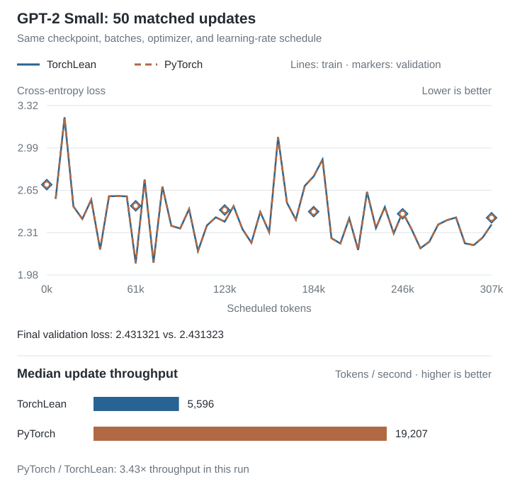

# Training a GPT-2-style model in Lean

Andrej Karpathy's [`minGPT`](https://github.com/karpathy/minGPT) and
[`nanoGPT`](https://github.com/karpathy/nanoGPT) made the GPT training recipe unusually easy to
study: you tokenize a corpus, train a decoder-only Transformer to predict the next token, and look
at the continuations it learns. I wanted to know how much of that experiment I could carry out from
Lean without shrinking it into a miniature demonstration.

I trained all 124,412,160 stored parameters of a GPT-2-style model in strict FP32 on one NVIDIA
A100. After a first run over one billion FineWeb-Edu tokens, I resumed from its best saved
checkpoint and kept training on another shard, which brings that parameter history to exactly
2,319,208,448 scheduled tokens. Its best validation loss was 3.135083. At the very end the loss went
back up, though, and the final checkpoint measured 3.273021.

The base model learned! Turning it into an assistant went much less well. I ran two rounds of
assistant-masked instruction tuning, and both validation losses fell, but the final checkpoint still
gave confident wrong answers to elementary questions. So the language-model training worked, and
this small instruction-tuning recipe didn't produce a good chat model.

The model, training loop, checkpoint loader, cached decoder, and the theorem statements are all
written in Lean. If you want something quick to try first, a smaller Tiny Shakespeare preset runs
the same program in about two minutes on one A100. For the story of the experiment, see the
companion essay,
[*Training a GPT-2-style model in Lean*](https://robertboy18.github.io/TorchLean-Verified-Examples/week-03-gpt-training/).
This README is for the commands, measurements, and Lean statements.

## What came from minGPT and nanoGPT

Like the minGPT and nanoGPT teaching implementations, the model uses the GPT-2 tokenizer,
pre-normalized decoder blocks, causal self-attention, GELU feed-forward layers, tied token
embeddings, AdamW, linear warmup, cosine decay, and autoregressive sampling.

I didn't try to reproduce nanoGPT line for line. My reported run used strict FP32 on one GPU and
trained on FineWeb-Edu (instead of WebText or OpenWebText), and the query, key, and value
projections in the current TorchLean model are bias-free. Week 3 also adds exact-bit parameter
files, resumable AdamW checkpoints, run passports, LeanProfiler traces, assistant-token masks, a
key/value cache, and the Lean proofs described later in this README. What connects it to Karpathy is
the training recipe and the readable style of the experiment, not identical code or weights.

## Build

If Lean isn't installed yet, install it through Elan. Then clone this repository and build the
Week 3 proofs:

```bash
curl --proto '=https' --tlsv1.2 -sSf \
  https://raw.githubusercontent.com/leanprover/elan/master/elan-init.sh | sh
source "$HOME/.elan/env"

git clone https://github.com/Robertboy18/TorchLean-Verified-Examples.git
cd TorchLean-Verified-Examples

python3 -m venv .venv
source .venv/bin/activate
# Linux/NVIDIA example; see the root README for CPU-only Python installation.
python -m pip install torch==2.13.0 --index-url https://download.pytorch.org/whl/cu126
python -m pip install -r requirements.txt

lake build TorchLeanGPT
```

That last command checks the Lean model and theorem modules, and it doesn't need a GPU.
`lake-manifest.json` records the tested dependencies, so an ordinary build uses those revisions
without running `lake update`. To compile the training and cached-generation executables with
LibTorch's CUDA backend, first point `TORCHLEAN_LIBTORCH_HOME` (or `-Klibtorch_home=PATH`) at a
compatible LibTorch SDK. Then run:

```bash
lake -R -Kcuda=true \
  -KverifiedExamplesBuildDir=.lake/build-cuda \
  -KtorchleanBuildDir=.lake/build-cuda build \
  train_torchlean_gpt \
  generate_torchlean_gpt \
  generate_torchlean_gpt_cached \
  check_torchlean_gpt_cache \
  benchmark_torchlean_gpt_cache
```

We reuse LibTorch for matrix products, normalization, activations, and cached attention, and the
example-local C++ adapter only owns the persistent key/value cache (it no longer maintains separate
CUDA kernels). CMake reads the compiler and linker settings of the SDK you selected, and SDK
discovery may also need a matching CUDA development toolkit (select it with `CUDA_HOME` or
`-Kcuda_home`). When you invoke the executables through `lake exe`, pass the same build-directory
and SDK options. Without `-Kcuda=true` the proof modules and ordinary CPU execution are still
available, but calls to the native cached decoder report that LibTorch was not linked. And CPU
execution is very slow. On a busy 96-core machine, one quick-preset update of 32 tokens took 138-160
seconds, and the default two-update quick run with an 8-token completion took about 18 minutes
([log](results/current-runtime-checks/quick-cpu-train.log)).

Every initializer in the tied-model builder comes from one seed stream. To reproduce a trained
model's predictions, though, you load its checkpoint instead of reinitializing its weights.

The runner's native scalar is `Float`, and TorchLean now keeps its binary64 precision on CPU and
GPU, optimizer state and key/value cache included. Each Week 3 command prints
`[TorchLean] arithmetic: Lean Float (IEEE-754 binary64)` when it starts. All the FP32 measurements
below describe the completed training runs, and a new binary64 run uses more memory and can have
different timings and rounding results.

For CUDA discovery and the CPU-only build on Linux and macOS, see TorchLean's
[installation guide](https://lean-dojo.github.io/TorchLean/installation/).

## Model configuration

TorchLean's tied-token constructor supplies the architecture:

```lean
def buildModel (cfg : nn.models.CausalTransformer.Config) (batch : Nat)
    (runtime : Runtime.Config) :
    nn.Builder (nn.IndexedModel (cfg.tokenShape [batch]) (cfg.vocabularyShape [batch])
      (Fin cfg.vocabularySize)) := do
  let model ← nn.models.CausalTransformer.tied cfg [batch]
  -- the rest wraps `model` and keeps the LayerNorm epsilon described below
```

This builds the whole indexed language model: a token table, learned positions, pre-normalized
blocks, hard causal attention, GELU feed-forward layers, and the final LayerNorm. Embedding lookup
uses the token table as it is, and vocabulary projection uses its transpose. Token ids are
represented as `Fin vocab`, so an out-of-range id can't reach the model, and they never pass through
a floating-point representation that could round them. All the dimensions sit in one ordinary
structure:

```lean
def gpt2Small : ModelConfig :=
  { context := 1024
    vocab := 50257
    width := 768
    heads := 12
    layers := 12 }
```

Week 3's `buildModel` keeps the original runtime's LayerNorm epsilon, which is `1e-5` on CPU and
`1e-6` on CUDA (the native cached decoder uses `1e-6` too). TorchLean's current constructor uses
`1e-5` and doesn't expose this setting in its Transformer config, so the runner sets the epsilon at
the model's operation boundary. Both the forward pass and its gradients use the selected backend's
value, and CUDA full-prefix and cached decoding agree on it. Why does this matter? If you load an
existing checkpoint, the parameter bits alone don't preserve a model whose normalization formula has
changed. And any comparison between CPU and CUDA includes this difference in epsilon too.

With one shared `(vocab × width)` matrix for input lookup and output projection (as in GPT-2), the
large preset has about 124.4 million stored parameters. TorchLean's current query, key, and value
projections are bias-free, though, so the experiment matches GPT-2-small's main dimensions and
weight tying without claiming bit-for-bit compatibility with an OpenAI checkpoint.

Initialization follows GPT-2 as well. Embeddings and ordinary projections draw from a normal
distribution with standard deviation `0.02`, but the attention output and second feed-forward
projections write into residual streams, so they use `0.02 / sqrt(2 * layers)` (about `0.00408` for
GPT-2 small). That depth-dependent factor keeps the variance contributed by 24 residual branches
from accumulating at full scale. You'll find it exposed through `residualProjectionInitialization?`
instead of hidden in the training script. It's the convention implemented by
[Hugging Face's GPT-2 model](https://github.com/huggingface/transformers/blob/main/src/transformers/models/gpt2/modeling_gpt2.py)
and described in OpenAI's
[GPT-2 report](https://cdn.openai.com/better-language-models/language_models_are_unsupervised_multitask_learners.pdf).

## Prepare the data

From the repository root:

```bash
python -m pip install -r requirements.txt
python week-03-gpt-training/tools/prepare_dataset.py
```

This downloads Tiny Shakespeare, tokenizes it with GPT-2 BPE, and writes `train.bin` and `val.bin`
(each a sequence of little-endian unsigned 16-bit token ids), plus a JSON manifest with token counts
and SHA-256 hashes. There's no pickle file or executable Python object for the Lean loader to trust.

You can also give the same script local text:

```bash
python week-03-gpt-training/tools/prepare_dataset.py \
  --input notes.txt \
  --output week-03-gpt-training/data/notes
```

For larger experiments, `--hf-dataset` streams a Hugging Face dataset and writes the same shard
format, so the corpus never has to be held in memory.

### FineWeb-Edu

[FineWeb-Edu](https://huggingface.co/datasets/HuggingFaceFW/fineweb-edu) is a filtered English web
corpus released by Hugging Face, and its `sample-10BT` configuration is large enough for this
experiment without the full dataset. This command streams about 1.02 billion tokens and reserves
roughly one percent of the documents for validation:

```bash
python week-03-gpt-training/tools/prepare_dataset.py \
  --hf-dataset HuggingFaceFW/fineweb-edu \
  --hf-config sample-10BT \
  --hf-revision 87f09149ef4734204d70ed1d046ddc9ca3f2b8f9 \
  --max-tokens 1020000000 \
  --validation-fraction 0.01 \
  --output week-03-gpt-training/data/fineweb-edu-1b
```

`manifest.json` records the dataset revision, the tokenizer package version, the exact split sizes,
and the hashes. On the Lean side, the loader keeps the corpus in its compact two-byte representation
and decodes only the windows it samples, so a billion-token shard no longer expands into a boxed
`Array Nat` before training.

## Run a small check first

Build the CUDA executable:

```bash
lake -R -K cuda=true build train_torchlean_gpt
```

Then run the quick model:

```bash
LEAN_PROFILE=1 lake -R -K cuda=true exe train_torchlean_gpt --device cuda \
  --preset quick \
  --steps 200 \
  --batch 4 \
  --eval-every 25 \
  --save-params week-03-gpt-training/artifacts/quick.tlf32 \
  --tokenizer-vocab week-03-gpt-training/data/tinyshakespeare/vocab.json \
  --tokenizer-merges week-03-gpt-training/data/tinyshakespeare/merges.txt \
  --prompt "To be, or not to be" \
  --generate 8
```

That one command trains, evaluates, saves the exact parameter bits, and samples a continuation.
Along the way it also writes:

- `training-metrics.json`, with the observed training and validation losses
- `run-passport.json`, with the model dimensions, data paths, selected backend profile, parameter
  count, learning-rate schedule, and relevant theorem names
- `build/leanprofiler-trace.json`, a trace you can open in Perfetto
- `build/leanprofiler-summary.json`, with the aggregated timings

On one A100 the command above took about two minutes from the shell, but the program itself ran for
only 28 seconds (9.4 of them writing the checkpoint), and one update took about 39 ms
([log](results/current-runtime-checks/quick-cuda-train.log),
[profile](results/current-runtime-checks/quick-cuda-leanprofiler-summary.json)).

I also tested a one-step CUDA smoke run that used the full 50,257-token GPT-2 vocabulary, 3,317,184
stored parameters, and real Tiny Shakespeare shards. It got through data loading, validation, a
forward/backward AdamW update, checkpoint writing, and autoregressive generation. One update only
checks the program, of course, and doesn't train a meaningful model.

## First run: one billion tokens

Here's the configuration I measured on one A100:

```bash
LEAN_PROFILE=1 LEAN_STACK_SIZE_KB=8388608 lake -R -K cuda=true exe train_torchlean_gpt --device cuda \
  --preset gpt2-small \
  --train-bin week-03-gpt-training/data/fineweb-edu-1b/train.bin \
  --val-bin week-03-gpt-training/data/fineweb-edu-1b/val.bin \
  --batch 8 \
  --token-budget 1000000000 \
  --lr 0.0006 \
  --min-lr 0.00006 \
  --warmup-steps 2000 \
  --eval-every 1000 \
  --eval-batches 8 \
  --checkpoint-dir week-03-gpt-training/artifacts/gpt2-small-1b-checkpoints \
  --checkpoint-every 5000 \
  --save-params week-03-gpt-training/artifacts/gpt2-small-1b.tlf32 \
  --metrics week-03-gpt-training/artifacts/gpt2-small-1b-metrics.json \
  --passport week-03-gpt-training/artifacts/gpt2-small-1b-passport.json
```

`LEAN_STACK_SIZE_KB` gives the current runtime enough stack to write GPT-2-small checkpoints (see
"Checkpoint size" below). From the selected batch size and context length, the runner converts
`--token-budget` to optimizer updates, so the final update may take the scheduled total past the
requested budget by less than one batch. Both the metric stream and the run passport record the
warmup-and-cosine schedule, which is part of TorchLean's public training API.

With batch 8, the completed one-A100 run processed 1,000,005,632 tokens in 122,071 optimizer steps.
Strict FP32 training averaged 5,998 tokens per second, and with validation and checkpoint writes
included the run took about 46 hours and 35 minutes. Validation loss fell from 10.963 at
initialization to a best value of 3.308 at step 107,000, then rose to 3.488 by the final step.
(These measurements describe TorchLean's eager CUDA path on one A100 80GB, not a general hardware
claim.)

But the lowest-loss evaluation didn't land on a checkpoint boundary. Among the saved checkpoints,
step 100,000 was best (validation loss 3.333), so the continuation below starts from that checkpoint
instead of the final step, where validation loss had risen to 3.488.

One billion tokens was enough to show genuine learning and to exercise the complete training,
evaluation, profiling, and checkpoint path. It's still much less pretraining than the original GPT-2
recipe, so I'm not presenting this checkpoint as a reproduction of OpenAI's trained weights.

## Continue to 2.319 billion tokens

So which token count does the continuation build on? The full base run reached 1,000,005,632
scheduled tokens, but with batch 8 and context 1,024, the step-100,000 checkpoint had processed
exactly 819,200,000 scheduled tokens. That checkpoint is what the continuation loads, instead of the
final base parameters.

For the second FineWeb-Edu shard, the script skips the documents consumed while preparing the first
one and writes another 1.53 billion tokens:

```bash
python week-03-gpt-training/tools/prepare_dataset.py \
  --hf-dataset HuggingFaceFW/fineweb-edu \
  --hf-config sample-10BT \
  --hf-revision 87f09149ef4734204d70ed1d046ddc9ca3f2b8f9 \
  --hf-split train \
  --skip-documents 988690 \
  --max-tokens 1530000000 \
  --validation-fraction 0.01 \
  --output week-03-gpt-training/data/fineweb-edu-continuation-1.5b
```

With the pinned revision, the first command reads 988,690 `sample-10BT` documents before it reaches
1.02 billion tokens, so that's the skip for a disjoint second shard
([count](results/current-runtime-checks/fineweb-edu-documents-read.json)). New manifests record this
number as `source_documents_read`. My archived continuation shard came from an earlier version of
this command, with `--skip-documents 964709` and no `--hf-config`. Without `--hf-config` the loader
reads the default configuration, which starts with the 2013 crawl, and 964,709 is close to that
configuration's count (964,788 documents for 1.02 billion tokens), not to the `sample-10BT` one. Do
the two archived shards overlap, then? I can't tell, because the files I kept don't record which
configuration the first shard used.

Run the 1.5B-token continuation with:

```bash
LEAN_STACK_SIZE_KB=8388608 lake -R -K cuda=true exe train_torchlean_gpt --device cuda \
  --preset gpt2-small \
  --train-bin week-03-gpt-training/data/fineweb-edu-continuation-1.5b/train.bin \
  --val-bin week-03-gpt-training/data/fineweb-edu-continuation-1.5b/val.bin \
  --batch 12 \
  --token-budget 1500000000 \
  --lr 0.0001 \
  --min-lr 0.00001 \
  --warmup-steps 1000 \
  --eval-every 1000 \
  --eval-batches 8 \
  --checkpoint-dir \
    week-03-gpt-training/artifacts/gpt2-small-continuation/checkpoints \
  --checkpoint-every 10000 \
  --load-params \
    week-03-gpt-training/artifacts/gpt2-small-1b-checkpoints/step-100000/parameters.tlf32 \
  --save-params \
    week-03-gpt-training/artifacts/gpt2-small-continuation/final-parameters.tlf32 \
  --metrics \
    week-03-gpt-training/artifacts/gpt2-small-continuation/training-metrics.json \
  --passport \
    week-03-gpt-training/artifacts/gpt2-small-continuation/run-passport.json
```

The continuation completed 122,071 updates and scheduled 1,500,008,448 new tokens. Since it started
from the original step-100,000 checkpoint, the complete parameter history contains exactly
2,319,208,448 scheduled training tokens. Validation loss began at 3.483929 and reached its lowest
measured value, 3.135083, at continuation step 122,000. Then it went back up. At step 122,071 the
final evaluation was 3.273021, so the loss rose over the last 71 updates, at the minimum learning
rate `1e-5` and on the same fixed validation windows. Once again the lowest evaluation fell between
checkpoint boundaries (every 10,000 steps here), which leaves the final parameter file as the
closest saved state and not an exact copy of the step-122,000 model.

My dated local directory is named `gpt2-small-2.5b-continuation-20260806`, where `2.5b` was a
convenient target label and not the measured token count. For a fresh run, the clean paths in the
command above are the better choice.

If the process stops after writing a resumable checkpoint, rerun the same command with the same
model, data, optimizer, and schedule options, but replace `--load-params ...` with:

```text
--resume week-03-gpt-training/artifacts/gpt2-small-continuation/checkpoints
```

`--resume` restores the model parameters, the AdamW moments, the completed global step, and the
metric history. If the checkpoint's recorded training configuration doesn't match the resumed
command, the runner rejects it.

## Instruction tuning: the objective learned, the assistant did not

A pretrained checkpoint is a next-token model, not a chat assistant. I used two rounds of supervised
instruction tuning to ask a narrower question: could the same 124.4M-parameter model learn a
`User:`/`Assistant:` convention without any change to the TorchLean training engine? Loss is charged
only to assistant targets. Prompt tokens stay visible through causal attention, but their rows get
zero direct loss weight.

Stage 1 uses
[`HuggingFaceTB/smol-smoltalk`](https://huggingface.co/datasets/HuggingFaceTB/smol-smoltalk).
Stage 2 draws round-robin from five direct-answer splits in
[`HuggingFaceTB/smoltalk2`](https://huggingface.co/datasets/HuggingFaceTB/smoltalk2): everyday
conversation, science, summarization, instruction following, and OpenHermes dialogue. Round-robin
streaming matters here, because otherwise the first large split would use up the complete token
budget.

Prepare the two datasets with:

```bash
python week-03-gpt-training/tools/prepare_dataset.py \
  --hf-dataset HuggingFaceTB/smol-smoltalk \
  --hf-revision f73fe857d519ff6ac5af2ea67c4d3834da7b8bcc \
  --messages-column messages \
  --max-tokens 12000000 \
  --validation-fraction 0.01 \
  --output week-03-gpt-training/data/smol-smoltalk-10m

python week-03-gpt-training/tools/prepare_dataset.py \
  --hf-dataset HuggingFaceTB/smoltalk2 \
  --hf-revision fc6cc2103c066455aade5d7fbb346039ae36ca5e \
  --hf-config SFT \
  --hf-split smoltalk_smollm3_everyday_conversations_no_think \
  --hf-split Mixture_of_Thoughts_science_no_think \
  --hf-split smoltalk_smollm3_smol_summarize_no_think \
  --hf-split tulu_3_sft_personas_instruction_following_no_think \
  --hf-split OpenHermes_2.5_no_think \
  --messages-column messages \
  --max-tokens 50000000 \
  --validation-fraction 0.01 \
  --output week-03-gpt-training/data/smoltalk2-balanced-50m
```

Each output contains compact token shards, an aligned byte-per-token target mask, and
`train.records`/`val.records`. A record stores a bounded input window and the exact assistant-target
interval inside it. Long assistant answers become several records with overlapping context, but no
record crosses a dialogue boundary. When it loads them, the Lean loader checks that the ordered
target intervals don't overlap, stay inside their token windows, name only active mask entries, and
cover every active target exactly once. Run passports and the resumable-checkpoint identity also
include the record files and their hashes.

Inside a sampled record, the batch loader shifts the target by one token, pads after the end of the
record, and gives nonzero row weights only to that record's assistant interval. TorchLean supplies
the weighted row loss, and this example defines the transcript, the target mask, and the dialogue
records.

After pretraining, run both instruction-tuning stages with:

```bash
bash week-03-gpt-training/tools/run_instruction_tuning.sh \
  week-03-gpt-training/artifacts/gpt2-small-continuation/final-parameters.tlf32 \
  reproduced-sft
```

After Stage 1 the script picks the lowest-loss saved checkpoint and starts Stage 2 from it. Its
second argument names the output directories under `week-03-gpt-training/artifacts/`. On a machine
with more than one GPU, set `CUDA_VISIBLE_DEVICES` before the command.

In my runs, Stage 1 loaded the final 2.319B-token pretrained parameters and scheduled 10,002,432
token rows, and Stage 2 loaded the best Stage 1 checkpoint and scheduled another 50,006,016 rows
from the broader mixture. Both ran on the same A100 with batch 6. Validation is a fixed,
deterministic sample of eight batches (not an average over every record in the validation shard).

| Stage | Updates | Initial validation loss | Best validation loss | Runtime |
| --- | ---: | ---: | ---: | ---: |
| SmolTalk, 10M | 1,628 | 2.673017 | 2.135422 at step 1,628 | about 31 minutes |
| SmolTalk2 mixture, 50M | 8,139 | 2.818384 | 2.216872 at step 8,139 | about 2h 35m |

Don't compare values across stages, because the two validation shards differ. Within each stage the
sampled assistant-target loss fell throughout training. Stage 2 had one small rise at step 2,000 and
then kept going down. In both stages the lowest sampled value came at the final evaluation, so the
script selected steps 1,628 and 8,139.

Generation told a less flattering story. Under deterministic greedy decoding, the repaired Stage 2
checkpoint still failed elementary prompts (greedy here means `--top-k 1` with the generators'
default repeat penalty, which I explain below):

```text
User: What is 2+2? Answer just number.
Assistant: 2+2 = 2 +1

User: What instrument did Bartolomeo Cristofori invent? Answer briefly.
Assistant: The instrument Bartolomeo Cristofori invented was the "Cambrian" or "Italian"
instrument. This instrument was a combination of the Italian and Spanish instruments, which
were used in various European countries during the Renaissance period.
```

A note on "greedy". Before it picks a token, every Week 3 generator subtracts a repeat penalty from
the scores: `1.05` times the number of times that token appears among the last 64 token ids, prompt
included. So `--top-k 1` takes the argmax of the penalized scores, not of the raw logits. That value
used to be hard-coded in the generators, which is why every output in this section used it. It's now
`--repeat-penalty` (and `--repeat-window`) with the same defaults, and `--repeat-penalty 0` turns it
off.

Then I tried a broader fixed greedy suite with no system prompt. Paris and the water summary were
correct, and the model recognized that the film review was positive, but it ignored the requested
one-word format. It failed `7 + 5`, gave the wrong explanation for a blue sky, refused a harmless
rewrite, emitted malformed Python, and confidently attributed the telescope to James Cook. You can
read the complete prompts and verbatim outputs in
[`results/instruction-prompt-suite.json`](results/instruction-prompt-suite.json). I also tried the
default system message and top-k sampling, and neither made the checkpoint reliable.

Could a transcript mismatch explain this? To rule it out I decoded an actual validation record,
which contained the Cristofori question with the exact prefix emitted by the interactive generator
and the target `Piano`. The checkpoint failed that prompt too. That doesn't mean the optimization
run was broken (the measured objective did improve). What it means is that 2.319B pretraining tokens
followed by this 60M-row SFT recipe were not enough to make a dependable assistant at this model
size.

There was an earlier failed run as well. Its sampler drew arbitrary windows from one concatenated
dialogue tape, so a window could begin inside an answer or cross into another conversation. That bug
is what motivated the record format and Lean checks above, and the table in this section reports the
full rerun after the repair (not the flawed run).

The measured checkpoints are:

```text
week-03-gpt-training/artifacts/dialogue-bounded-from-2.319b-20260812-smoltalk-10m/checkpoints/step-1628/parameters.tlf32
week-03-gpt-training/artifacts/dialogue-bounded-from-2.319b-20260812-smoltalk2-50m/checkpoints/step-8139/parameters.tlf32
```

Stage 1 loaded `gpt2-small-2.5b-continuation-20260806/final-parameters.tlf32`, and Stage 2 loaded
the selected Stage 1 checkpoint. I kept the dated `2.5b` directory name for provenance, even though
the exact pretraining history contains 2.319B scheduled tokens.

## A matched PyTorch run

That long TorchLean run shows the model can learn. But are TorchLean and PyTorch optimizing the same
function? One run alone can't tell us, so I reconstructed the Week 3 model in PyTorch directly from
the TorchLean checkpoint and ran both trainers for 50 updates, with the same checkpoint, dialogue
records, sampled batches, assistant-row weights, AdamW parameters, and warmup-cosine schedule. Both
programs ran sequentially on the same A100. PyTorch TF32 was disabled, and both CUDA paths stored
model tensors as `float32`. PyTorch used scaled-dot-product attention and fused AdamW, while
TorchLean used its native CUDA runtime.

In TorchLean the first two-batch validation mean was `2.694593`, against `2.694594` in PyTorch, and
after 50 updates the values were `2.431321` and `2.431323`. Across the complete run, the largest
absolute difference between paired training losses was `1.19e-5`, and for the six validation
measurements it was `1.93e-6`.



Curves this close are strong evidence that the checkpoint layout, forward pass, target selection,
loss, backward pass, and AdamW update agree on this run. It's a differential test, though, not a
Lean proof of runtime equivalence (the structural theorems in the next section have a different
job).

Speed is another matter. Median update throughput was `5,596` scheduled tokens per second for
TorchLean and `19,207` for PyTorch, so PyTorch was `3.43x` faster in this matched 50-update
measurement. That number applies to this model, batch, software build, and A100, and it isn't a
universal backend ratio.

Run the comparison with:

```bash
CUDA_VISIBLE_DEVICES=0 \
  bash week-03-gpt-training/tools/run_matched_comparison.sh \
    week-03-gpt-training/artifacts/matched-runtime /path/to/current-checkpoint.json
```

The saved figure above is from the original FP32 run. Because the current Lean runner uses binary64,
the script now runs the PyTorch reference in `float64` too, target weights and optimizer state
included. Both metric files record their precision, and the comparison rejects a mismatch. You need
to supply a checkpoint for the GPT-2-small dimensions, saved by the current TorchLean runtime.
Either binary64 state JSON or streamed binary32 state (`TLSF32B`, version 1) works, and the
reference converts the latter to binary64 just as the Lean runner does. New metrics, the summary,
and the figure go under the output directory you choose, and the example directory above keeps the
saved FP32 results unchanged. How do we know those two archived metric files are FP32? They were
written before either program recorded a dtype, so the label comes from the setup of that run, not
from a field in the files: the TorchLean CUDA runtime of that time (Lean 4.33, as its passport
records) stored `Float` tensors as binary32, and the PyTorch reference built its model in `float32`
with TF32 off (its file records only `"tf32": false`). For a smaller run, the Python reference also
accepts `--context`, `--vocab`, `--width`, `--heads`, and `--layers`, matching the Lean model
options.

## What Lean proves

These proofs are about the causal structure that every training step uses, not about facts like one
preset's parameter count.

| Claim | Lean source | Status |
| --- | --- | --- |
| Every training row predicts the following corpus token | `causal_window_target_is_next_token`, `causal_record_target_is_next_token` | Proved for the two batch builders the trainer calls |
| An assistant-only mask follows the target token, not the input token | `causal_window_mask_is_next_target` | Proved for the dialogue batch builder the trainer calls |
| The executable selector agrees with the dialogue-record predicate | `DialogueRecords.targetRowEnabled_eq_true_iff` | Proved |
| Every selected record target lies inside its bounded token window | `DialogueRecords.target_index_lt_record_end` | Proved |
| Padded rows after the end of a record cannot be selected as targets | `DialogueRecords.not_target_row_of_record_end_le` | Proved |
| The packing loop appends every input, target, and mask bit in row order | `Batching.appendRows_toList`, `Batching.appendRows_getElem?` | Proved for arbitrary row functions and initial arrays; used by the masked batch builder |
| A validation scan accepts exactly when every entry passes, otherwise finding the first failure | `Validation.firstInvalid.spec`, `Validation.firstInvalid_eq_none_iff` | Proved for arbitrary Boolean checks; used by the token and mask loaders |
| A strict-future attention entry has zero weight and zero score derivative | `causal_attention_blocks_future_forward_and_backward` | Proved for the exact hard-mask specification |
| Zero-weight rows make no direct contribution to a weighted sum | `weighted_rows_eq_of_eq_on_support` | Proved algebraically; this theorem does not differentiate the runtime loss |
| Incremental key/value caching agrees with full-prefix recomputation | `CachedDecode.run_correct`, `Layered.run_correct` | Proved for the abstract cache semantics |
| A sufficiently small logit error preserves a greedy continuation | `Generation.greedy_eq_of_rollout_certified` | Proved when the stated per-prefix certificates are supplied |
| Restoring an exact indexed training state gives the uninterrupted result | `Training.resume_eq_uninterrupted` | Proved under exact-state restoration |
| The native CUDA cache agrees numerically with ordinary TorchLean decoding | `check_torchlean_gpt_cache` | Runtime differential check, not a refinement theorem |
| CUDA forward, backward, and AdamW execution implement the real-valued specifications | TorchLean backend capsules | Trusted runtime boundary |

### Proving the data loops

I wanted the loop proofs to describe the code the trainer actually calls, and Lean 4.35's `Std.WP`
and `vcgen` let us prove a mutable range loop with a prefix invariant. So the implementation still
pushes into arrays and exits a scan at its first failure. In the contracts, the lists describe the
processed prefix rather than allocating runtime indices.

[`Batching.appendRows`](TorchLeanGPT/Batching.lean) is used inside
`causalLmMaskedTokenBatchFromRecords`, which packs the whole batch in one row-major pass. After each
iteration, its three arrays contain exactly the initial entries followed by the processed rows. The
contract talks about their contents, not just their lengths, so swapping two targets would violate
it even if every shape still matched. The row function stays arbitrary, and inputs and targets can
have different types.

`readTokenShard` and `readTargetMask` share
[`Validation.firstInvalid`](TorchLeanGPT/Validation.lean), whose invariant records that every
earlier index passed the check. If the loop stops, the returned index is in range, fails the check,
and has no earlier failure. If it finishes, every index passed (and that covers empty inputs too).
Both loaders keep their existing file formats and diagnostic messages.

These are proofs of the pure packing and scanning functions, and the target and mask theorems below
then read the trainer's batch tensors back entry by entry. None of these proofs verify filesystem
reads, the byte decoder, or the CUDA kernels. Ordinary Lean proofs discharge the loop obligations,
and the implementation uses the standard `for` syntax throughout.

You can run the compiled regression checks without a GPU:

```bash
data_check_dir=$(mktemp -d)
lake exe check_torchlean_gpt_data "$data_check_dir"
```

The checks compare masked tensors against a list-based reference at empty, padded, partial-record,
and full-window boundaries, then exercise valid, truncated, and invalid shard files. Because the
packing and scanning functions themselves have proofs, I didn't keep their development sweeps as a
permanent test suite. Fixtures stay in the printed scratch directory for inspection.

The target and mask theorems sit in [`Run.lean`](TorchLeanGPT/Run.lean), next to the two batch
builders the trainer calls. First, in a pretraining batch the target at position `t` is the corpus
token at position `t + 1`, which is also the input at position `t + 1`:

```lean
theorem causal_window_target_is_next_token
    (vocab batch seqLen : Nat) [NeZero vocab]
    (shard : Run.TokenShard) (seed step padId : Nat) (bi : Fin batch) (i : Fin seqLen) :
    let batchTensors := Run.causalLmTokenBatchFromShard vocab batch seqLen shard seed step padId
    let start := (text.Corpus.randomBatchOffsets shard.size seqLen batch seed step).getScalar bi
    (batchTensors.2.get bi).getScalar i =
        Fin.ofNat vocab (shard.getD (start + i.val + 1) padId) ∧
      ∀ j : Fin seqLen, j.val = i.val + 1 →
        (batchTensors.2.get bi).getScalar i = (batchTensors.1.get bi).getScalar j
```

`causal_record_target_is_next_token` says the same for dialogue batches inside each sampled record,
and it also shows that rows past the record's end are padding.

For instruction tuning the loss mask follows the same target shift, so row `t` reads the mask for
corpus token `t + 1` and not the mask attached to its input token:

```lean
theorem causal_window_mask_is_next_target
    {α : Type} [Storage α] [_root_.Context α] [Runtime.FromFloat α]
    (vocab batch seqLen : Nat) [NeZero vocab]
    (shard : Run.TokenShard) (targetMask : Run.TargetMask) (records : Run.DialogueRecords)
    (seed step padId : Nat) (bi : Fin batch) (i : Fin seqLen) :
    let batchTensors := Run.causalLmMaskedTokenBatchFromRecords (α := α)
      vocab batch seqLen shard targetMask records seed step padId
    let record := Run.sampledRecord records seed step bi.val
    let weight := Run.activeRowWeight
      (Run.recordBatchRows shard targetMask records seed step padId batch seqLen).2.2
    (batchTensors.2.2.get bi).getScalar i =
      Runtime.ofFloat
        (if decide (i.val + 1 < record.length) &&
            DialogueRecords.targetRowEnabled
              record.offset record.targetOffset record.targetLength i.val &&
            targetMask.getD (DialogueRecords.targetIndex record.offset i.val) then
          weight
        else
          0)
```

Here `DialogueRecords.targetIndex record.offset i` is `record.offset + i + 1`, the same position
that supplies the row's target token. Every enabled row gets the same weight (one over the number of
enabled rows in the batch).

Dialogue records add a second indexing invariant. If a row belongs to a record's assistant-target
interval, the corpus position it predicts is still strictly inside that record's token window:

```lean
theorem target_index_lt_record_end
    (hTargetsInside : targetOffset + targetLength ≤ offset + length)
    (hRow : isTargetRow offset targetOffset targetLength row) :
    targetIndex offset row < offset + length
```

A complementary theorem excludes every padded row at or after the record end. Both propositions
describe pure index arithmetic, and the file parser separately checks the concrete record payload
against the concrete target mask before training begins.

Finally, a strict-future position is blocked in both directions, with attention weight exactly zero
in the forward pass and score gradient exactly zero in the backward pass:

```lean
theorem causal_attention_blocks_future_forward_and_backward
    {context : Nat}
    (scores dWeights : TorchLean.Tensor ℝ
      (.dim context (.dim context .scalar)))
    (i j : Fin context)
    (future : i.val < j.val) :
    let weights :=
      Spec.hardMaskedSoftmaxSpec scores (Spec.causalMask context)
    Spec.get2 weights i j = 0 ∧
      Spec.get2
        (Spec.softmaxBackwardFromWeightsSpec weights dWeights) i j = 0
```

This theorem quantifies over every score matrix and every incoming attention-weight gradient of the
given shape, and it proves both the attention weight and the derivative with respect to that score
coordinate. On its own it doesn't verify the CUDA kernel, and it doesn't claim that every query,
key, value, and model parameter derivative has been connected to the specification.

For the assistant-only objective the statement is just as direct. If two rows of losses agree
wherever the row weight is nonzero, their weighted totals are equal:

```lean
theorem weighted_rows_eq_of_eq_on_support
    {n : Nat} (weights left right : Fin n → ℝ)
    (hEqual : ∀ i, weights i ≠ 0 → left i = right i) :
    ∑ i, weights i * left i = ∑ i, weights i * right i
```

Once the corresponding row-derivative equalities have been established separately, the same support
argument can be used coordinate by coordinate. But the theorem itself is about a weighted sum, and
it doesn't prove differentiation of `Loss.crossEntropyWeighted` or the autograd implementation.
Prompt tokens can still influence an active assistant target through causal attention (that's
intentional).

Build the proofs directly with:

```bash
lake build TorchLeanGPT
```

## Generate text from a checkpoint

Git ignores the data shards and measured checkpoints because they're large local artifacts, and the
preparation and training commands above create the paths used below. There's no public download for
the measured Week 3 checkpoint yet, so from a clean clone you have to train one or substitute a
compatible local parameter file.

A separate generation executable reconstructs the same model and loads the saved parameter bits:

```bash
lake -R -K cuda=true exe generate_torchlean_gpt --device cuda \
  --preset quick \
  --load-params week-03-gpt-training/artifacts/quick.tlf32 \
  --tokenizer-vocab week-03-gpt-training/data/tinyshakespeare/vocab.json \
  --tokenizer-merges week-03-gpt-training/data/tinyshakespeare/merges.txt \
  --system ""
```

This opens an interactive prompt. The quick model has only 16 positions, so `--system ""` drops the
default system message (which alone would not fit), and without `--generate` the reply fills
whatever context the transcript leaves (up to 96 tokens on larger models). Keep in mind that a base
language model completes text and isn't automatically a helpful assistant. The executable supports a
`User:`/`Assistant:` transcript format so that a checkpoint fine-tuned on dialogue data can use the
same interface, but you should judge the Tiny Shakespeare run as text completion. Interactive
generation stops at the tokenizer's end-of-text token and advances the sampling seed between turns.

You can open the repaired 50M instruction-tuning checkpoint through the cached generator. If you
leave out `--message`, it starts an interactive loop and keeps the transcript until it reaches the
1,024-token context limit:

```bash
lake -R -K cuda=true exe generate_torchlean_gpt_cached --device cuda \
  --preset gpt2-small \
  --load-params \
    week-03-gpt-training/artifacts/dialogue-bounded-from-2.319b-20260812-smoltalk2-50m/checkpoints/step-8139/parameters.tlf32 \
  --tokenizer-vocab week-03-gpt-training/data/smoltalk2-balanced-50m/vocab.json \
  --tokenizer-merges week-03-gpt-training/data/smoltalk2-balanced-50m/merges.txt \
  --system "" \
  --generate 64 \
  --temperature 0.8 \
  --top-k 40
```

For one noninteractive answer, append `--message "What is two plus two?"`. That's handy for poking
at the checkpoint, but judge its assistant quality by the failed generation tests above.

Checkpoints preserve parameter values and check their shapes when loading. `Float` uses exact
binary64 JSON on CPU and GPU, `Float32` uses binary32 payloads, and the cached decoder uses the same
dtype as the live parameters. (Binary32 parameter files can also be loaded into a binary64 model.) A
file written with `--save-params` stores only model parameters, which is enough to begin a new phase
such as instruction tuning. A resumable checkpoint directory also stores the AdamW moments, the
completed step, the metric history, and the training configuration needed to reject an incompatible
resume request. New `resume.v2` manifests record 64-bit content hashes of the training, validation,
mask, and dialogue-record shards, enough to catch ordinary accidental changes (the SHA-256 values in
the dataset manifest provide the stronger archival identity). Checkpoints also record the device,
backend profile, Lean version, and optimizer label. Random windows are derived from the seed and
step number, so resuming at the recorded step restores the data-stream position too. The current
version-5 optimizer payload also saves the session's random-operation counter, and restoring it
continues dropout with the next mask instead of restarting the mask sequence. Optimizer payloads
from versions 2–4 are rejected. To use their model weights with the current runtime, pass the
parameter file to `--load-params`; this starts fresh optimizer moments and is not an exact resume.

My completed 2.319B-token continuation used the earlier `resume.v1` format, whose manifests bind
paths and training options but not content hashes or runtime identity. The manifest reader still
recognizes it with a warning, but continuing its older optimizer state requires the runtime that
wrote that payload. New checkpoints use `resume.v2` with version-5 optimizer payloads.

[`Training.resume_eq_uninterrupted`](TorchLeanGPT/TrainingCorrectness.lean) proves the corresponding
pure training statement: for any step-indexed update rule, running `first` steps and then
`remaining` steps from the saved state gives the same state as running all `first + remaining` steps
at once. It assumes that the saved state is restored exactly and that both runs use the same global
step indices. Parsing a checkpoint and restoring its device buffers are checked by the executable,
and they aren't hidden inside that theorem.

Before the LibTorch migration, the Lean 4.34 regression ran three CUDA AdamW updates with dropout
`0.1`, then resumed the step-one checkpoint and repeated the remaining two updates. Both the final
parameter file and the optimizer file came out byte-identical. That test used width 8, two heads,
one layer, context 32, batch size 1, seed 19, and the full 50,257-token vocabulary, so it checks the
serializer, random counter, and loader on a small model. It's an observed result, not a guarantee of
bitwise determinism for every CUDA run. Since the pure theorem assumes the same step-indexed update
rule in both runs, and atomic accumulation can change the order of floating-point additions, set
`TORCHLEAN_CUDA_DETERMINISTIC_REDUCTIONS=1` for both the original run and its continuation when you
check repeatability.

A separate pre-migration Lean 4.34 smoke test initialized the full GPT-2-small preset (124,412,160
stored parameters, 12 layers, width 768, 12 heads, context 1,024) and ran one CUDA training update
on TinyShakespeare with batch size 1 and seed 19. On the selected evaluation batch, validation loss
fell from `11.010458` to `9.484279`, and the parameter checkpoint was saved. That tests the
full-size training path, not convergence or the quality of a newly trained language model.

### Checkpoint size

With the current `Float` runtime, a GPT-2-small parameter-only file is about 2.95 GiB (3,172,502,859
bytes, 25.5 bytes per parameter). Despite the `.tlf32` name, it's pretty-printed JSON
(`torchlean_state_bits_v1`) holding every value's 64-bit pattern. That extension is left over from
the binary32 stream that the archived FP32 runs wrote, which was about 475 MiB. A resumable AdamW
checkpoint also stores both optimizer moments, in a binary64 `optimizer.tladam` file of 1.85 GiB, so
one checkpoint directory is about 4.8 GiB
([measurement](results/current-runtime-checks/gpt2-small-checkpoint-sizes.json)).

Writing a GPT-2-small `Float` checkpoint needs a larger Lean thread stack than the default. With the
default stack, a one-update GPT-2-small run finished its update and then hung while writing its
first checkpoint ([details](results/current-runtime-checks/gpt2-small-default-stack-hang.txt)).
Setting `LEAN_STACK_SIZE_KB=8388608` (8 GiB) before the command fixed it, and
`run_instruction_tuning.sh` sets that value unless you choose another. Loading the same file worked
with the default stack, though.

For a long run, keep the checkpoint named by `LATEST`, one previous recovery point, the best
held-out parameter file, and the final parameter file. Older optimizer snapshots are only useful
while you still need their exact restart point.

Look at a run before you remove anything:

```bash
cat week-03-gpt-training/artifacts/RUN/checkpoints/LATEST
du -h --max-depth=2 week-03-gpt-training/artifacts/RUN/checkpoints | sort -h
```

## Fast generation with a key/value cache

The ordinary generator is a useful reference implementation, but after sampling a token it evaluates
the complete padded prefix again, which repeats the key and value projections for every earlier
token. The cached generator evaluates each token once and keeps one key/value row per layer and
attention head.

Build the chat command, differential checker, and benchmark together:

```bash
lake -R -K cuda=true build \
  generate_torchlean_gpt_cached \
  check_torchlean_gpt_cache \
  benchmark_torchlean_gpt_cache
```

The cached command takes the same checkpoint and tokenizer as the ordinary generator:

```bash
lake -R -K cuda=true exe generate_torchlean_gpt_cached --device cuda \
  --preset gpt2-small \
  --load-params \
    week-03-gpt-training/artifacts/dialogue-bounded-from-2.319b-20260812-smoltalk2-50m/checkpoints/step-8139/parameters.tlf32 \
  --tokenizer-vocab week-03-gpt-training/data/smoltalk2-balanced-50m/vocab.json \
  --tokenizer-merges week-03-gpt-training/data/smoltalk2-balanced-50m/merges.txt \
  --system "" \
  --message "Hello!" \
  --generate 64
```

Since the model still uses its learned absolute positions, the prompt and continuation must fit
within the configured context. For GPT-2 small the key/value table itself occupied 72 MiB in the
archived FP32 implementation, and the current binary64 implementation uses 144 MiB for the same full
table:

```text
2 * 12 layers * 12 heads * 1024 positions * 64 values * 8 bytes = 144 MiB
```

`CachedDecode.Correctness` gives one causal layer a representation invariant:
`Cache.Represents kernel history cache` says that the cached rows are exactly the key and value
projections of `history`, in order. Its main theorem proves both the returned outputs and the final
cache:

```lean
theorem run_correct
    {history suffix : List Token} {cache : Cache Key Value}
    (h : cache.Represents kernel history) :
    (run kernel cache suffix).2 = recompute kernel history suffix ∧
      (run kernel cache suffix).1.Represents kernel (history ++ suffix)
```

`run_eq_recompute` specializes this result to an empty cache, and the construction is then lifted
through a list of causal layers. `Layered.Represents` records the history seen at every layer, and
`Layered.run_correct` proves that incremental execution of the complete stack agrees with
full-prefix recomputation while preserving every layer cache. The prefix theorems use equality of
arbitrary prefixes (not only the special case you get by appending tokens). None of these results
depends on GPT-2 small, FP32, or CUDA.

The representation invariant fixes the cache geometry too:

```lean
theorem represents_cache_lengths
    (h : Layered.Represents layers caches history) :
    caches.map Cache.length = List.replicate layers.length history.length
```

So there's one cache for every layer, and each layer contains exactly one key/value row for every
consumed state. Deeper layers store different states, but all layer caches advance by the same
number of positions.

The native implementation is a runtime boundary. Before decoding, Lean checks every state position
and shape the configured model expects, validates the attention configuration, and checks every
dimension passed to the native ABI. Optional dropout probabilities occupy state slots even in
evaluation mode, so the decoder checks those slots and skips them when it selects weights. Attention
projections use input-by-output matrices, while the feed-forward projections use output-by-input
matrices. All three LayerNorm sites use Week 3's CUDA epsilon, `1e-6`, matching the ordinary CUDA
forward pass (the CPU forward pass keeps `1e-5`). And the checkpoint format is positional. It
doesn't carry semantic parameter names, so a same-shaped reordering would still violate the format
contract, and no name check would catch it. This command compares the native cache with the ordinary
TorchLean forward pass on one loaded checkpoint:

```bash
lake -R -K cuda=true exe check_torchlean_gpt_cache --device cuda \
  --preset gpt2-small \
  --load-params \
    week-03-gpt-training/artifacts/dialogue-bounded-from-2.319b-20260812-smoltalk2-50m/checkpoints/step-8139/parameters.tlf32 \
  --tokenizer-vocab week-03-gpt-training/data/smoltalk2-balanced-50m/vocab.json \
  --tokenizer-merges week-03-gpt-training/data/smoltalk2-balanced-50m/merges.txt \
  --system "" \
  --message "Hello!"
```

The next two results are archived. They come from the earlier FP32 implementation, which still had
its own CUDA kernels, and the first one used the step-8,139 checkpoint, which isn't public. On the
A100 used for this example, I checked the complete 50,257-entry logit vector at three prefixes:

| Prefix tokens | Maximum absolute difference | Mean absolute difference | Winner margin | Margin check |
| ---: | ---: | ---: | ---: | ---: |
| 1 | 0.000018 | 0.000003 | 0.351320 | passed |
| 4 | 0.000014 | 0.000002 | 2.112649 | passed |
| 9 | 0.000017 | 0.000003 | 4.891603 | passed |

The smoke-test checkpoint above was checked at prefixes of 1, 4, and 8 tokens, with maximum absolute
logit differences of `0.000003`, `0.000002`, and `0.000003` respectively. Greedy choices agreed, and
all three margin checks passed.

I reran the checker on the current LibTorch adapter, in binary64. There's no public trained
checkpoint, so I used a GPT-2-small model initialized with seed 19 and trained for one update on
Tiny Shakespeare, with the same `--system ""` and `--message "Hello!"` and the GPT-2 tokenizer
files. At prefixes 1, 4, and 9 the largest absolute differences were `5.3e-15`, `4.4e-15`, and
`3.6e-15`, greedy choices agreed, and all three margin checks passed
([log](results/current-runtime-checks/gpt2-small-cache-check.log)). The 200-update quick checkpoint
gave about `3e-15` ([log](results/current-runtime-checks/quick-cache-check.log)).

The checker rejects non-finite logits, unequal output lengths, a changed greedy token, or a maximum
absolute difference above `0.001`. It also reports whether twice the observed error is below the
reference winner margin, as `margin_stable=true`. The winner and its margin are taken after the
repeat penalty the decoder applies, so they describe the token it would actually choose
(`--repeat-penalty 0` checks raw logits instead). That's an observed numerical condition, not a Lean
certificate for the native kernel. Under NVIDIA Compute Sanitizer, the archived 124M-parameter cache
path reported zero memory errors, and on the current adapter `compute-sanitizer --tool memcheck`
also reported zero errors for the check on both checkpoints above
([GPT-2 small](results/current-runtime-checks/gpt2-small-cache-memcheck.log),
[quick](results/current-runtime-checks/quick-cache-memcheck.log)).

For a greedy timing comparison, run:

```bash
lake -R -K cuda=true exe benchmark_torchlean_gpt_cache --device cuda \
  --preset gpt2-small \
  --load-params \
    week-03-gpt-training/artifacts/dialogue-bounded-from-2.319b-20260812-smoltalk2-50m/checkpoints/step-8139/parameters.tlf32 \
  --tokenizer-vocab week-03-gpt-training/data/smoltalk2-balanced-50m/vocab.json \
  --tokenizer-merges week-03-gpt-training/data/smoltalk2-balanced-50m/merges.txt \
  --system "" \
  --message "hey" \
  --generate 16 \
  --seed 0 \
  --top-k 1
```

In the archived FP32 implementation, across three warm runs of the selected step-8,139 checkpoint,
the full-prefix generator took 9.43-9.74 seconds and cached prefill plus generation took 168-172 ms.
That's a 56.3x-56.8x end-to-end speedup! Both paths generated the same eleven token ids before
reaching the end-of-text token in every run. That machine had an NVIDIA A100-SXM4-80GB, driver
575.57.08, and the CUDA 11.0 compiler. These numbers describe that checkpoint and environment, and I
included the command so other machines can report their own result.

Today's LibTorch adapter computes in binary64. With the one-update GPT-2-small checkpoint and the
Tiny Shakespeare copy of the GPT-2 tokenizer files, three runs of the command took 25.5-26.6 seconds
for the full-prefix generator and 383-416 ms for cached prefill plus generation, a 64.0x-66.6x
end-to-end speedup. Both paths produced the same 16 token ids in every run (this barely trained
model never reached the end-of-text token). These runs used an NVIDIA A100-SXM4-80GB with driver
580.167.08, CUDA 13.0, and the LibTorch from PyTorch 2.13.0
([summary](results/current-runtime-checks/gpt2-small-cache-benchmark-summary.json)).

Equal argmax indices in three measurements are useful evidence, but the Lean result is stated for
every decoding step. Both paths subtract the same repeat penalty before choosing, and the penalty
depends only on the history, so the argument below applies to the penalized scores. Suppose the
reference logits have winner margin `m`, the cached logits are within `ε` in the infinity norm, and
`2ε < m`. Then the two paths choose the same next token. `greedy_eq_of_rollout_certified` applies
that argument recursively, asking for certificates only on the prefixes the ideal greedy path
reaches, and concludes that the complete continuation is identical for the certified length. But a
numerical run establishes these hypotheses only for the prefixes it actually checks. For now the
differential checker reports the required errors and margins, but it doesn't construct a Lean
`StepCertified` term, and I haven't written a checked parser that turns the report into that
proposition yet.

## Plot the loss and profile

Turn the metric and LeanProfiler summaries into two standalone SVGs:

```bash
python week-03-gpt-training/tools/render_profile.py \
  --metrics week-03-gpt-training/artifacts/training-metrics.json \
  --summary build/leanprofiler-summary.json \
  --output week-03-gpt-training/artifacts/figures
```

`loss.svg` plots training and validation loss, and `profile.svg` shows where the host process spent
its time, including data loading, initialization, training, evaluation, checkpointing, and
generation.
