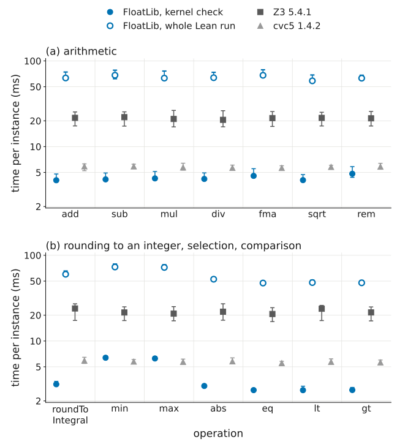
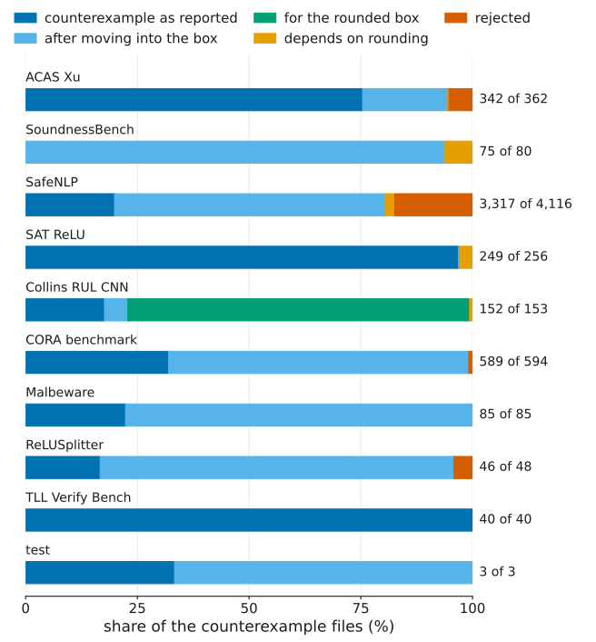
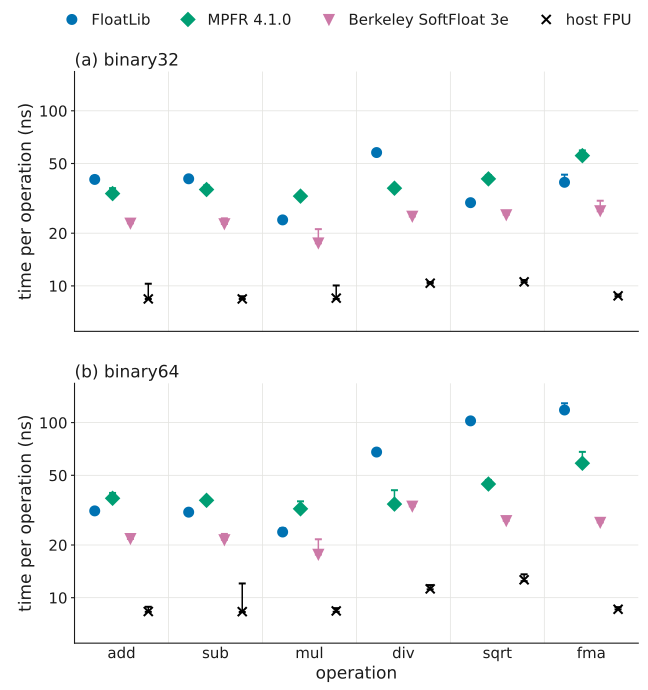

# So, how fast is numerical computation in Lean?

FloatLib 4.1.0 is out! For anyone who hasn't been following these posts, [FloatLib](https://github.com/lean-dojo/FloatLib) is our library for floating-point arithmetic and verified numerical computation in Lean. It started out as something we needed for TorchLean, but at this point we're using it for quite a few things that have little to do with neural networks (computer algebra, numerical analysis, PDEs, etc.). I've been meaning to see how FloatLib performs on benchmarks that weren't written by us. There is something mildly unsatisfying about developing a numerical tactic and then evaluating it on examples that you chose yourself. So this week I collected eleven existing benchmarks, mostly from numerical analysis, SMT solving, control theory and NN verification, and ran FloatLib on them.

tl;dr: some pretty good results, some rather embarrassing ones, and a few things that I didn't quite expect. In particular, 281 of LLM2Cert's 291 proof obligations go through with a single `by interval`, all 39,994 floating-point conformance tests in SMT-LIB's Wintersteiger family are proved, and computing with 4,096-bit floats inside Lean's kernel is surprisingly cheap.

## A bit of context

FloatLib now supports IEEE binary and decimal floating-point formats, arbitrary precision, posits and various smaller formats used in ML. We have executable arithmetic, specifications of what that arithmetic should do, and proofs relating the two. The three tactics relevant to this post are:

- `float_decide`: decide closed floating-point propositions by computation inside the kernel.
- `interval`: prove inequalities over the reals using certified interval arithmetic and branch-and-bound.
- `roundoff`: prove rounding error bounds for numerical programs.

E.g.,

```lean
import FloatLib
open FloatLib.Floats

example : (1.5 : Binary32) + 2.25 = 3.75 := by
  float_decide
```

Nothing particularly exciting about the statement itself. The nice part is that we're doing the arithmetic inside the kernel, without relying on `native_decide` or calling an external numerical library whose output we then have to trust. For the proof experiments below, I also checked `#print axioms` (only `propext`, `Classical.choice` and `Quot.sound`). The compiled evaluation experiments are a separate matter, as we'll see later.

## LLM2Cert without the LLM (for the proof part!)

I came across [LLM2Cert](https://github.com/FormalCert-AI/llm2cert), which uses LLMs to synthesize Lyapunov functions and barrier certificates for dynamical systems. Very cool work. In their All-Lean setting, the LLM also produces Lean proofs of the conditions that these functions need to satisfy. Most of these conditions are inequalities. Given a candidate Lyapunov function \(V\), for instance, we might need to establish that \(V(x)>0\) away from the equilibrium and that its derivative along the dynamics satisfies

\[
\nabla V(x)^\top f(x)<0
\]

on some prescribed domain. Finding such a \(V\) can be very difficult; checking these conditions for a given \(V\) is a somewhat different problem. Looking at their DynaCertBench dataset, I figured that `interval` should be able to do quite a bit here. I took their definitions and statements verbatim and replaced all 291 proofs with

```lean
by interval
```

And, well:

| | Obligations | Complete certificates |
|---|---:|---:|
| LLM2Cert (All-Lean) | 274/291 | 64/81 |
| `interval` | 281/291 | 71/81 |
| `interval` (raised limits) | 282/291 | 72/81 |


The default run takes 43.8 minutes of cumulative Lean time across all 291 obligations. Their published results report 13.6 hours of Lean time on the successful obligations and ~1.94M model tokens. The machines and experimental setups differ, so don't take the ratio of these times too seriously. Of course, we're not synthesizing the Lyapunov functions here! LLM2Cert already did that. But I think this is a nice example of where we should be using LLMs and where we probably shouldn't. Let the model figure out what the certificate ought to be, and let the numerical tactic deal with the ensuing inequalities. Spending model tokens trying to prove hundreds of individual inequalities seems unnecessary if we can automate the mathematics once.

Three of the remaining obligations concern radial unboundedness, i.e., \(V(x)\to\infty\) as \(\|x\|\to\infty\). This isn't really in the scope of our current interval tactic. The other failures are more interesting from the point of view of improving the search procedure.

[Details, statements and scripts](llm2cert/)

## 39,994 little floating-point theorems

SMT-LIB has a large collection of floating-point benchmarks under its QF_FP logic. Of particular interest here is the Wintersteiger family: 39,994 tests where the operands are fixed and we are asked whether a particular binary64 operation produces a specified result. These aren't really search problems. They're conformance tests for floating-point implementations, covering arithmetic, FMA, sqrt, remainder, comparisons, rounding, etc. I translated all of them into Lean statements about FloatLib's arithmetic and ran `float_decide`.

39,994/39,994, with zero disagreements. Nice!



There is an interesting distinction between the cost of the arithmetic and the cost of getting Lean to actually prove something about it. On a sample of 1,400 instances, we get the following median times:

| | Time |
|---|---:|
| Actual numerical decision in Lean's kernel | 0.48 ms |
| Kernel checking the entire proof | 4.11 ms |
| Entire Lean pipeline (batched) | 62.3 ms |
| Z3 (one process per instance) | 23.5 ms |
| cvc5 (one process per instance) | 5.75 ms |

A lot of the kernel time is spent checking the rewrites from the public floating-point operations to the operations that the kernel evaluates. The actual arithmetic accounts for a relatively small portion of the work. I suspect we can do much better w.r.t. the construction of these proofs. FWIW, the SMT solvers are considerably faster end-to-end, particularly when we also allow them to process benchmarks in batches. We are measuring something slightly different in Lean, since we additionally produce and check a theorem about the numerical operation. Also, QF_FP contains genuinely difficult satisfiability problems where the operands aren't known. `float_decide` doesn't magically turn into Bitwuzla in this setting (unfortunately).

[Full QF_FP results](smtlib-qf-fp/)

## Nonlinear real arithmetic (things get a bit worse)

The QF_NRA benchmarks are more challenging for us. Here we have polynomial constraints over real-valued variables, and we want to prove that no assignment satisfies all the constraints. Our current approach uses interval arithmetic to bound expressions over boxes, subdividing a box whenever we can't rule out the constraints on it. The individual exclusion arguments are certified, so a successful search results in a proof in Lean.

Out of 3,064 translated candidate UNSAT instances outside the MetiTarski family, there are 66 for which we can extract bounds on all the variables. With a 60s budget, we prove 56 of them.

| | Solved |
|---|---:|
| FloatLib | 56/66 |
| Z3 | 51/66 |
| cvc5 | 60/66 |
| Yices | 62/66 |


Coverage isn't too bad on these particular examples, but the timings are another story. The SMT solvers take ~20–30ms in the median; we take 7.3s, including loading Lean. On the other 1,065 candidates that SMT-COMP 2025 ran, we prove a grand total of 17. Oof.

The issue here is essentially the search. Subdividing a high-dimensional box without exploiting enough of the algebraic structure of the constraints gets expensive very quickly. I'd like to borrow more ideas from existing SMT solvers: constraint propagation, elimination of variables, polynomial reasoning, better branching heuristics, etc. There's no shortage of really good mathematics and algorithms in this literature. Another approach would be to let an external solver do more of the search and have it return something we can check efficiently in Lean. We don't necessarily need to formalize every detail of the search algorithm.

[Full QF_NRA results](smtlib-qf-nra/)

## When is a counterexample actually a counterexample?

Probably my favourite experiment this week. At VNN-COMP, a neural network verifier that returns SAT can provide a witness: some input \(x\) for which the network violates the property. Sounds straightforward enough, but what exactly is \(x\)? What arithmetic are we using to compute the network? Are we interpreting the network as a composition of real-valued functions, or are we evaluating it in binary32? What order are the sums accumulated in?

These distinctions matter much more than one might initially think. Take the rather boring example of an input constraint

\[
x\leq 0.1.
\]

The binary32 number nearest to \(0.1\) is actually

\[
0.100000001490116119384765625.
\]

So if the specification is over the reals, rounding the decimal witness to binary32 can give us an input that is no longer in the specified domain. We haven't even started evaluating the NN yet!

I replayed 5,737 published counterexample files from ten VNN-COMP 2025 benchmark families. For each supported network, we evaluated the network using FloatLib's binary32 arithmetic (four different orders of summation) and exact rational arithmetic, and checked the corresponding input and output constraints.



| | Files |
|---|---:|
| Valid as reported | 1,625 |
| Valid after moving the input into the box | 3,156 |
| Valid for rounded input bounds only | 117 |
| Depends on rounding | 97 |
| Rejected | 742 |

Quite a few of the witnesses only become valid when we move their coordinates to the nearest binary32 numbers inside the input box. The median violation of the input constraints in the relevant boundary cases is only ~7e-9. For 97 files, whether we actually have a counterexample depends on the numerical evaluation.

Before anyone gets the wrong idea: the 742 rejected files do **not** amount to 742 incorrect SAT results. For those instances, there are other valid witnesses. Of the 1,004 SAT instances in these families, we found exact counterexamples for 974, rounded-box counterexamples for another 18, and couldn't replay the remaining 12 because of the size of the networks. We also found counterexamples to 476 UNSAT results, 466 of which the competition already penalizes using its own scoring tolerance. The full replay uses compiled Lean code. For the smaller networks, we additionally have 18,414 kernel-checked theorems. We're checking witnesses here, not verifying arbitrary neural networks.

This gets at one of the things that originally bothered me about NN verification. Proving a theorem about some real-valued abstraction of a network is perfectly reasonable mathematics, but relating it to the program being executed is a mathematical problem in its own right. If the program uses a different numerical semantics, what precisely have we proved about it? Hopefully we'll be able to explore this at a much larger scale with TorchLean.

[Full VNN-COMP results](vnncomp-replay/)

## Roundoff: proving the bound rather than printing it

Given a numerical program, how far is its output from the mathematical quantity that it's supposed to compute? There are quite a few nice tools for this problem already, e.g., Gappa, FPTaylor and NumFuzz. I took the 80 programs in the [NumFuzz](https://github.com/ak-2485/NumFuzz) artifact and attempted to prove their forward error bounds using `roundoff`. We get 75/80. On the 17 smaller examples in their paper, our bounds agree with NumFuzz's on 13 and are tighter on four. Gappa does better than us on seven examples (up to a factor of two), since it makes better use of the direction of the individual rounding errors. NumFuzz computes its bounds in milliseconds; we take 1.7–68s to establish the corresponding theorems.

What I like much more than the individual bounds, though, is being able to reason about algorithms of arbitrary length. Consider a dot product computed via serial summation,

\[
s_n=\sum_{i=1}^{n}a_i b_i.
\]

Under the usual floating-point assumptions, we can reason about how the error grows with \(n\). We shouldn't have to rerun a numerical error analyzer for every possible value of \(n\)! We can prove a general theorem about the loop and instantiate it whenever we need it. We do this for Horner's method, dot products and serial summation. This becomes particularly useful in ML, where a large fraction of the computations we're interested in are parameterized by tensor dimensions, batch sizes, etc.

I also ran `roundoff` on FPBench (136 programs, each in binary32 and binary64). We get 184 conditional forward error theorems, 180 closed-form error theorems and 22 backward error theorems. For 33 forward and 18 closed-form bounds, we're additionally able to discharge the premises over the specified input boxes. Another 84 cases don't translate yet. The conditional vs. unconditional distinction is worth mentioning. A theorem assuming that intermediate computations don't overflow is useful, but we may additionally need to prove that they don't overflow for the inputs we're actually interested in. This is another place where the different numerical tactics can help each other.

[NumFuzz](numfuzz/) · [FPBench](fpbench/)

## LeanCert!

[LeanCert](https://github.com/alerad/leancert) is another really nice library for certified numerical computation in Lean. I wanted to see where our interval tactics differ, both in performance and in what mathematics they can currently handle. I collected the goals from its benchmark suites, examples and tests, and gave them to both tactics. On the 357 goals within the scope of FloatLib's `interval`, we each prove 341, with 327 proved by both. On the intersection, the median times are 66ms for us and 638ms for LeanCert (using its kernel-checked route, rather than `native_decide`).

The 14 goals that LeanCert proves and we don't are arguably more useful to me than the timing comparison. Some involve finite sums of a hundred terms; others involve bounds on the Euler–Mascheroni constant. There are also another 62 goals outside the current scope of our interval tactic, involving things like integrals, roots and derivatives, of which LeanCert proves 30.

I'd love to see more interoperability between these libraries. It would be rather silly if everyone in Lean independently developed incompatible representations of certified intervals, approximation theorems and numerical certificates. There is a lot of room for sharing mathematical infrastructure here.

[Comparison with LeanCert](leancert/)

## 4,096-bit floats inside the kernel?!

I was curious about the cost of doing a single floating-point operation inside a proof checker, particularly at higher precisions. For this comparison, I used FloatLib in Lean and [Flocq](https://flocq.gitlabpages.inria.fr/) 4.2.2 in Coq 8.20.1, with identical operands and format widths ranging from 32 to 4,096 bits.


Here are the addition times in Lean:

| Width | Time |
|---|---:|
| 32 bits | 39.9 µs |
| 64 bits | 39.2 µs |
| 128 bits | 44.3 µs |
| 256 bits | 46.1 µs |
| 512 bits | 62.3 µs |
| 1,024 bits | 63.2 µs |
| 4,096 bits | 64.0 µs |

I find the last row particularly cool. Increasing the format width from 32 to 4,096 bits doesn't increase the cost nearly as much as one might expect for these operands. Across all the tested operations and widths, Lean takes between 39 and 276µs.

Where Coq's `vm_compute` finishes, the median ratio is 24x in FloatLib's favour. Coq's evaluation time grows considerably with precision, and several high-precision examples don't finish within the given resource limits. NB: Flocq is a much more established mathematical formalization of floating-point arithmetic, and its computational representation wasn't necessarily designed with this particular use case in mind. I wouldn't read these numbers as saying anything about the relative quality of the two formalizations. We're comparing the cost of evaluating certain operations in two proof checkers.

[Full comparison](kernel-vs-coq/)

## `native_decide`?

One thing I keep coming back to is whether we really need to resort to `native_decide` for numerical computations. Don't get me wrong, `native_decide` is very useful. But for numerical verification, avoiding the additional trust in Lean's compiled evaluation would be preferable whenever possible.

I ran a small comparison on six statements. On the five where both approaches succeed, the runtime of `decide +kernel` ranges from 0.90 to 2.04 times that of `native_decide`. On the sixth, `native_decide` fails and the kernel proves the statement in 6.2ms. Six statements hardly constitute a comprehensive benchmark, lol. Still, I think it's worth putting more effort into efficient kernel computation. For genuinely enormous calculations, certificate generation and checking will probably be the more useful approach.

[Details](kernel-vs-native-decide/)

## And outside the kernel?

We're also interested in using FloatLib as an actual numerical library, so I compared its compiled arithmetic with the host FPU, Berkeley SoftFloat and MPFR.



For binary32 and binary64, we are roughly at MPFR's speed on the twelve operation-format combinations tested, and faster in six of them. FloatLib takes 24–118ns per operation, the FPU 8–13ns, and SoftFloat is a median of 1.6x faster than us. High precision is a different story: between 256 and 4,096 bits, MPFR is 2.1–35x faster. We use an exact implementation over Lean's arbitrary-precision natural numbers at these widths, which is quite useful for proofs but leaves a lot of room for computational optimization.

There are some genuinely interesting verification problems here. Can we implement the kinds of fast multiword arithmetic algorithms used by numerical libraries such as MPFR, prove their correctness once, and use them both for efficient computation and formal reasoning? How much of this can we eventually move to GPUs without introducing additional trust assumptions about the arithmetic?

[Compiled arithmetic results](compiled-vs-mpfr-softfloat-fpu/)

## MetiTarski and Flyspeck

A couple of other benchmarks, mostly because I was curious about what would happen. With one call to `interval` and a 20s budget, we prove 340/948 MetiTarski goals. For Flyspeck, we manage to translate 20 of the 164 records and prove six of those. Much work remains here.

These are interesting problems involving nonlinear and transcendental inequalities. Simply increasing the precision or subdividing intervals more aggressively isn't necessarily the right way to solve them. Sometimes a suitable algebraic manipulation, monotonicity argument or change of variables can turn a seemingly difficult inequality into a trivial numerical calculation. Would be quite fun to develop tactics that discover these intermediate arguments.

[MetiTarski and Flyspeck](metitarski-flyspeck/)

## Some thoughts

I've been thinking quite a bit about what doing applied mathematics in Lean should look like. Suppose we're investigating a PDE and have found what appears to be a singularity profile numerically. We would like to compute the profile, study the linearized operator around it, estimate the residual, verify a stability argument, etc. Somewhere along the way, these calculations need to become rigorous mathematical statements. Why should the numerical experiments and the formal mathematics live in completely different worlds?

This is part of the motivation behind our work on [PDEAtlas](https://lean-dojo.github.io/PDEAtlas/), [SymLean](https://lean-dojo.github.io/SymLean/) and FloatLib. In an ideal world, I'd like to spend an afternoon playing around with a numerical algorithm in Lean, make an interesting observation, and then use the very same mathematical objects to formulate and prove a theorem about it. (We're obviously quite far from this being a pleasant experience for arbitrary problems.)

I also think the recent developments in AI for mathematics make this particularly relevant. The interesting thing for me isn't necessarily whether an LLM can write a proof of some horrible numerical inequality. I'd rather have it figure out *which* inequality we should prove! Or find a useful numerical profile, or identify the right mathematical abstraction, or notice that two apparently different arguments are really the same argument. The LLM2Cert experiment is a small illustration of this. Searching for a good Lyapunov function is interesting mathematics; generating 291 individual proofs of its numerical properties is something we should try to automate away.

There is still a rather long list of things to fix: arbitrary-precision performance, interval search in higher dimensions, reasoning about large numerical programs, verified GPU arithmetic, etc. The failure cases in these benchmarks should keep us busy for a while :)

## Reproducing things

Everything is in the [repo](https://github.com/Robertboy18/TorchLean-Verified-Examples/tree/master/week-09-floatlib-benchmarks), including the raw numbers, scripts, benchmark translations and figures. This week's experiments use their own Lake project with FloatLib 4.1.0 and Lean 4.36.0.

```bash
git clone https://github.com/Robertboy18/TorchLean-Verified-Examples.git
cd TorchLean-Verified-Examples/week-09-floatlib-benchmarks

lake update
lake exe cache get
lake build
```

To regenerate, e.g., the LLM2Cert figure:

```bash
python3 llm2cert/scripts/plot.py
```

Most runs are from Nov. 20–21, 2026, on a shared 96-thread Xeon. The Coq numbers are from a recorded Nov. 15 run, and some comparisons use the published results of other tools. There are detailed notes on the setup and limitations in the individual benchmark directories. The translations are tested scripts, and the LeanCert experiments use my port to Lean 4.36. [THIRD_PARTY.md](THIRD_PARTY.md) contains the benchmark sources and licenses.

If anyone has other numerical benchmarks that would be particularly painful for us, please send them over!

[FloatLib](https://github.com/lean-dojo/FloatLib) · [Website](https://lean-dojo.github.io/FloatLib/) · [Experimental results](https://github.com/Robertboy18/TorchLean-Verified-Examples/tree/master/week-09-floatlib-benchmarks)
