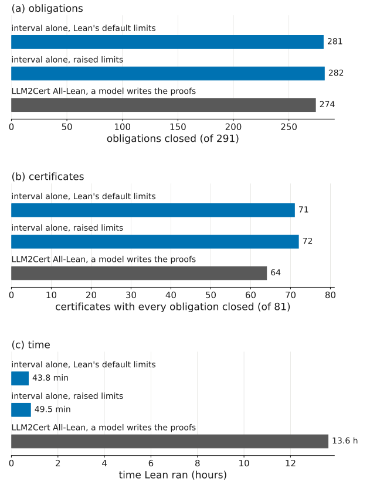
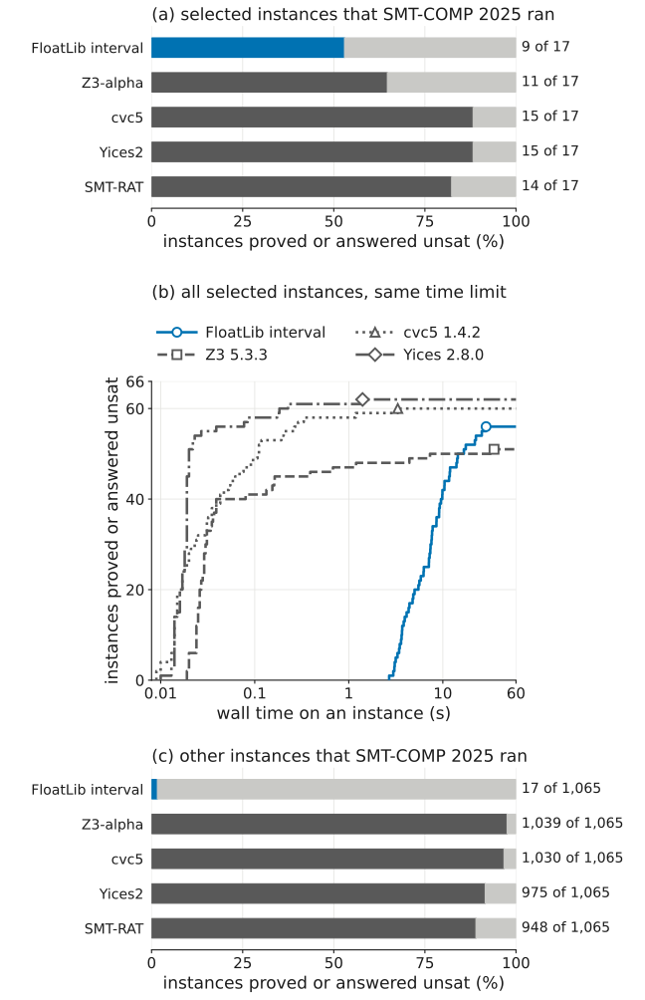
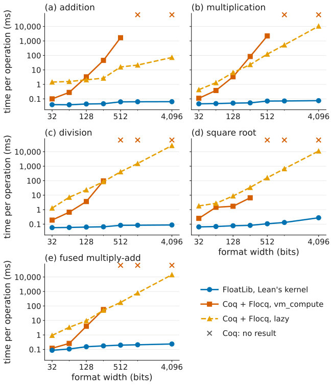

# FloatLib 4.1.0 on other people's benchmarks

[FloatLib](https://github.com/lean-dojo/FloatLib) has been sitting under these notes since
[week 1](../week-01-batch-invariant-inference/), where three binary32 numbers changed their sum with the order
of addition. It's our Lean library for floating-point arithmetic and verified numerical computation, and we just
released [version 4.1.0](https://github.com/lean-dojo/FloatLib/releases/tag/v4.1.0). Its own repository reports
what it proves and how fast it runs, with a harness that we wrote ourselves. So this week I did the
uncomfortable part: I ran it on benchmarks that other people built for their own tools, and wrote down what
happened.

Mostly it holds up. One line of `by interval` closes 281 of LLM2Cert's 291 proof obligations with no model,
`float_decide` proves all 39,994 SMT-LIB floating-point tests, and one float operation costs Lean's kernel 39 to
276 µs, where Coq with Flocq takes a median of 24 times as long. It also loses in places, and I've kept the
losses in, with their reasons. What FloatLib adds every time is a theorem that Lean's kernel checked.

## What FloatLib 4.1.0 is

FloatLib is a Lean 4 library for arbitrary precision floating-point arithmetic. It has executable operations,
numerical specifications and the proofs that connect them, for IEEE binary and decimal formats, posits, and the
low precision formats of machine learning. Three of its tactics do the work in this post:

- `float_decide` proves a closed floating-point statement by running the calculation in Lean's kernel with
  `decide +kernel`, so no compiler is trusted.
- `interval` proves real inequalities, and refutes sets of real constraints, with interval arithmetic and a
  branch and bound search.
- `roundoff` takes a program and proves a bound on its rounding error: forward, in closed form, or backward.

```lean
import FloatLib
open FloatLib.Floats

example : (1.5 : Binary32) + 2.25 = 3.75 := by float_decide
```

One rule holds for every count of proofs below: an instance counts only when Lean accepts it and
`#print axioms` shows `propext`, `Classical.choice` and `Quot.sound` and nothing else. The Lean runs are from
2026-11-20 and 2026-11-21, with Lean 4.36.0 on one shared 96-thread Xeon. Each section links to a directory with
the method, the versions, the full tables and what failed.

## LLM2Cert: 291 proof obligations and no model

[LLM2Cert](https://github.com/FormalCert-AI/llm2cert) synthesizes Lyapunov functions and barrier certificates
with a language model, and in its All-Lean setting a model also writes the Lean proofs of the obligations. Its
benchmark DynaCertBench has 291 of them, and all but three say that a set of real constraints has no point.
That is what `interval` refutes, so I replaced every proof by the one line `by interval`.

With Lean's default limits that closes 281 obligations in 43.8 minutes of Lean time, with no model anywhere. It
has nothing to say about the other three, which are statements on radial unboundedness. LLM2Cert's own records
have 274, with 1.94 million model tokens and 13.6 hours of Lean time (Figure 1). To be fair, its pipeline also
finds the certificates, and that's the hard part. What I take from this is narrower: once a certificate exists,
these obligations don't need a model. [Details and files](llm2cert/).

<figure class="data-chart" id="figure-1">
  
  <figcaption><strong>Figure 1.</strong> DynaCertBench's 291 obligations with <code>by interval</code> and no model (blue), next to LLM2Cert's own records (grey): (a) obligations closed, (b) certificates completed, of 81, (c) hours of Lean time.</figcaption>
</figure>

## SMT-LIB QF_FP: 39,994 conformance tests as theorems

SMT-LIB's floating-point benchmarks include 39,994 single-operation tests. Each fixes the operands and a
result, and asks whether one binary64 operation gives it. Hardware and Z3's arithmetic produced the expected
results, so for FloatLib this is a conformance test that someone else wrote. `float_decide` proves the
benchmark's status for all 39,994, and none disagrees.

Now the fair part. A solver folds the constants and answers, and that is faster: 5.8 ms per instance for cvc5
and 23.5 ms for Z3, against 62 ms for the whole Lean run. Lean's kernel check alone takes 4.1 ms (Figure 2). And
`float_decide` doesn't search, so it reaches none of the 275 search problems of SMT-COMP 2025, where Bitwuzla
solved 255. [Details and files](smtlib-qf-fp/).

<figure class="data-chart" id="figure-2">
  
  <figcaption><strong>Figure 2.</strong> Time per instance on SMT-LIB's single-operation floating-point tests (binary64), by operation: the whole Lean run of FloatLib's <code>float_decide</code> proof, its kernel check alone, and the solvers Z3 5.4.1 and cvc5 1.4.2, which give no proof. A marker is the median over 100 sampled instances of an operation, with whiskers from the 5th to the 95th percentile. The time axis is logarithmic, and lower is faster. Measured on 2026-11-21 with FloatLib 4.1.0 and Lean 4.36.0.</figcaption>
</figure>

## SMT-LIB QF_NRA: 56 of 66 where the variables are bounded

An unsatisfiable QF_NRA benchmark says that a set of polynomial constraints has no real solution. Outside the
MetiTarski family, 3,064 unsat candidates translate to a Lean goal, and in 66 of them the constraints bound
every variable. One call of `interval` with 60 seconds proves 56 of those 66. On the same machine Z3 5.3.3
answers 51, cvc5 1.4.2 answers 60 and Yices 2.8.0 answers 62 (Figure 3).

<figure class="data-chart" id="figure-3">
  
  <figcaption><strong>Figure 3.</strong> <code>interval</code> next to SMT solvers: (a) the 17 selected instances that SMT-COMP 2025 ran, (b) all 66 on one machine, against wall time, (c) the 1,065 other candidates that the competition ran.</figcaption>
</figure>

Where the solvers answer they need 0.02 to 0.03 seconds in the median, and `interval` needs 7.3, about 2 of
them to start Lean and load the library. Outside the selection it isn't close. Of the 1,065 other candidates
that SMT-COMP 2025 ran, `interval` proves 17 and four of the competition's solvers answer 948 to 1,039. Size is
most of the reason: of the 2,370 goals with more than 20 variables it proves one.
[Details and files](smtlib-qf-nra/).

## VNN-COMP 2025: checking published counterexamples exactly

A neural-network verifier that answers "sat" at VNN-COMP publishes a counterexample: an input point, in
decimals. That is a concrete floating-point claim, so FloatLib can check it exactly, in binary32 with four
orders of summation and in exact arithmetic.

I replayed 5,737 published files from ten benchmark families. Of these, 1,625 are counterexamples as reported,
and 3,156 more once the point is moved to the nearest binary32 number inside the box. Verifiers print points on
the faces of the box, and the nearest binary32 number is often just outside it, by 7e-9 in the median. Another
742 files are rejected, and for 97 the verdict depends on the order of summation (Figure 4). No "sat" result is
wrong, though: every instance behind a rejected file has another file that is an exact counterexample.

<figure class="data-chart" id="figure-4">
  
  <figcaption><strong>Figure 4.</strong> Verdicts of exact replay, one bar per benchmark family: a counterexample as reported, after the point is moved into the box, for the box with rounded bounds only, depending on rounding, or rejected.</figcaption>
</figure>

Replay also finds an exact counterexample for 476 "unsat" results, and VNN-COMP's own scoring with tolerance
1e-4 already penalises 466 of them. The verdicts come from compiled Lean code, and for the small networks they
are kernel theorems too, 18,414 of them. [Details and files](vnncomp-replay/).

## NumFuzz: the same bounds, as theorems

[NumFuzz](https://github.com/ak-2485/NumFuzz) is a type system that infers relative rounding error bounds, and
its paper compares it with FPTaylor and Gappa. I ran `roundoff` on the same programs, and the other tools'
numbers are the paper's.

`roundoff` proves the forward theorem of 75 of the artifact's 80 programs. On the paper's 17 small benchmarks its
bound equals NumFuzz's in 13 and is smaller in 4. Gappa's bound is smaller in 7, by up to a factor of 2, because
Gappa follows the direction of each rounding and FloatLib bounds a directed rounding by one unit roundoff on
both sides. NumFuzz is also far faster, since it prints a bound where Lean checks a theorem: 0.002 to 0.008
seconds per program against 1.7 to 68 for the theorem with its number.

What I like most here is the long programs. Horner's rule, the dot product and the serial sum are each proved
once, as a loop, for every length. [Details and files](numfuzz/).

## LeanCert: two interval tactics on the same goals

[LeanCert](https://github.com/alerad/leancert) is a Lean library for certified numerics, and the closest thing to
`interval` in Lean. I stated its benchmark suites as goals, added the statements its examples and tests prove,
and gave every goal to both tactics, one call each.

Over the 357 goals in `interval`'s scope, each tactic proves 341, and 327 are proved by both. On those
`interval` takes 66 ms in the median and LeanCert 638 ms. Among the 14 that only LeanCert proves are finite sums
of a hundred terms and bounds on the Euler-Mascheroni constant. Another 62 goals of its suites are outside
`interval` altogether (integrals, roots, derivatives), and LeanCert proves 30 of those. LeanCert's numbers are
for its kernel-checked route, since its default one closes certificates with `native_decide`.
[Details and files](leancert/).

## One operation in the kernel: Lean with FloatLib, Coq with Flocq

`float_decide` runs arithmetic in Lean's kernel, so what does one operation cost there? FloatLib's kernel path
takes 39 to 276 µs, from 32 to 4,096 bits. On the same operands, [Flocq](https://flocq.gitlabpages.inria.fr/)
4.2.2 in Coq 8.20.1 takes 1.4 to 31,329 times as long under `vm_compute` where it finishes, with a median of 24
(Figure 5). At binary32 the two are close. Flocq was built to prove theorems about floating point and not to
compute at 4,096 bits, so this compares two design goals more than two libraries.
[Details and files](kernel-vs-coq/).

<figure class="data-chart" id="figure-5">
  
  <figcaption><strong>Figure 5.</strong> Time of one operation inside the proof checker against format width, on logarithmic axes: FloatLib in Lean's kernel, and Flocq in Coq under vm_compute and under lazy. A cross marks a width where Coq gave no result.</figcaption>
</figure>

## `decide +kernel` against `native_decide`

FloatLib never uses `native_decide`, which compiles a statement and trusts the compiler. On five closed
statements `decide +kernel` takes 0.90 to 2.04 times the time of `native_decide`, which is the faster one on
three of them. On a sixth statement `native_decide` fails, and the kernel proves it in 6.2 ms.
[Details and files](kernel-vs-native-decide/).

## Compiled code: the host FPU, SoftFloat and MPFR

A proved software float is still software. FloatLib's public `Binary32` and `Binary64` operations take 24 to
118 ns in a compiled loop, where the host FPU takes 8 to 13 (Figure 6). Over the 12 cells (six operations in two formats)
FloatLib takes a median of 1.0 times the time of MPFR 4.1.0 and is faster in 6. Berkeley SoftFloat 3e is faster
in all 12, by a factor of 1.6 in the median. At wide precisions MPFR wins clearly. From 256 to 4,096 bits
FloatLib has only its exact baseline on Lean's arbitrary-precision naturals, and it takes 2.1 to 35 times MPFR's
time. [Details and files](compiled-vs-mpfr-softfloat-fpu/).

<figure class="data-chart" id="figure-6">
  
  <figcaption><strong>Figure 6.</strong> Time of FloatLib's public binary32 and binary64 operations in compiled code, next to the host processor's own arithmetic, Berkeley SoftFloat 3e and MPFR 4.1.0. A marker is the median of 9 trials of the time per operation in a loop in which each result selects the next operands, with whiskers from the fastest to the slowest trial. The time axis is logarithmic, and lower is faster. Measured on 2026-11-20 with FloatLib 4.1.0 and Lean 4.36.0.</figcaption>
</figure>

## FPBench with `roundoff`

FPBench is the standard collection of programs for rounding error tools: 272 cases here, 136 programs in binary32
and in binary64. `roundoff` proves 184 forward, 180 closed-form and 22 backward conditional theorems, which keep
their premises (for example, that nothing overflows). Its weak spot is the numerical bounds, where a second proof
discharges the premises on the input box and proves one number: 33 forward and 18 closed. Another 84 cases don't
translate. [Details and files](fpbench/).

## MetiTarski and Flyspeck with `interval`

Two classic sets of real inequalities, with one call of `interval` per goal and 20 seconds each. It proves 340 of
the 948 MetiTarski goals and 6 of the 164 Flyspeck records, of which only 20 translate. MetiTarski and the
Flyspeck project's own tools prove far more of their own problems. This measures one general tactic with a small
budget. [Details and files](metitarski-flyspeck/).

## How to reproduce

This week is its own Lake project, on Lean 4.36.0, separate from the repository's root project:

```bash
git clone https://github.com/Robertboy18/TorchLean-Verified-Examples.git
cd TorchLean-Verified-Examples/week-09-floatlib-benchmarks
lake update          # FloatLib v4.1.0, with the Mathlib it pins
lake exe cache get   # Mathlib's compiled files
lake build           # FloatLib, and a first check in FloatLibBenchmarks.lean
python3 llm2cert/scripts/plot.py   # redraws a figure from its result files (Python and matplotlib)
```

[THIRD_PARTY.md](THIRD_PARTY.md) lists every input with its version, its license and how to get it. One honest
note: I moved the scripts into this layout after the runs, redrew every figure from the files here and checked
the collectors of six suites against the raw logs, but I did not run Lean again from this directory. So if a
path needs a nudge, that's why, and please tell me.

## What is not claimed

- **No network is verified** in the VNN-COMP section. It checks published counterexamples, reports by benchmark
  family, and says nothing about any single tool.
- **Nothing here says that FloatLib replaces a solver.** On QF_FP and QF_NRA the solvers are faster and they
  search. FloatLib's answers are kernel-checked theorems on the instances it reaches.
- **A count says what a tactic did on that suite**, with one call and the stated limits. It doesn't say what the
  tactic does on all goals.
- **The times are from one shared, busy machine**, good to a factor of about 1.5 to 2. Where two tools were
  timed here, they were timed the same way. Published numbers (the SMT-COMP results, the NumFuzz paper,
  LLM2Cert's records) come from other machines, so those times are not a race.
- **Some runs are recorded ones.** The Coq times are from 2026-11-15. The FPBench, MetiTarski and Flyspeck counts
  are the suite runs recorded in FloatLib's repository, whose library sources differ from the 4.1.0 tag by one
  added corollary and the version number.
- **The translations are scripts, tested and not proved.** The QF_NRA translation passes a differential test at
  random points and 200 `sat` controls, and the neural-network readers agree with numpy, with onnxruntime up to
  rounding, and with an exact evaluation in Python. The theorems are about the translated statements.
- **LeanCert ran on a port** that I made, and the goals of its suites sit at the edge of its own evaluators by
  construction.
- **LLM2Cert does more than close obligations.** It finds the certificates.

## Why I care about this

I trust a library more after seeing it on problems it was never tuned for, next to tools that are very good at
their own jobs. A kernel-checked answer costs time, sometimes two orders of magnitude, and in exchange you get a
theorem and not an output. Where the gap is small, like the kernel check on QF_FP or the LeanCert goals, proof by
computation in Lean is already practical. Where it is large, like wide-precision arithmetic or goals with
hundreds of variables, we know what to work on next :)
