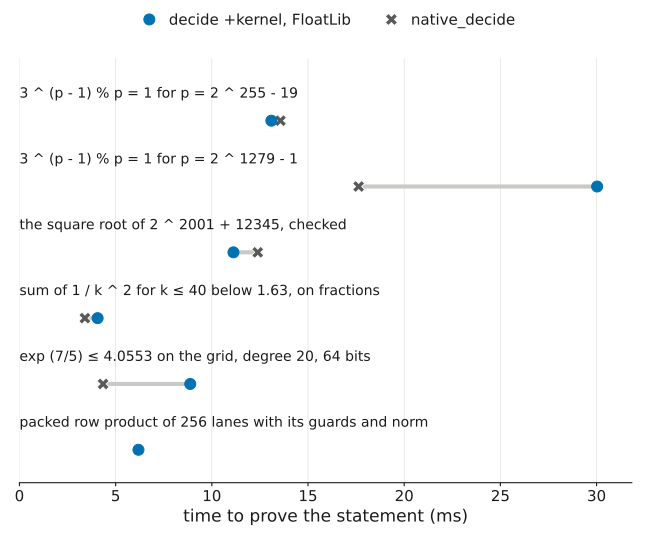

# `decide +kernel` on FloatLib's kernel layer against `native_decide`

Lean has two ways to prove a closed statement by running it. `native_decide` compiles the statement and trusts the
compiler and the code it produces. `decide +kernel` has Lean's kernel evaluate it, so nothing new is trusted.
FloatLib never uses `native_decide`: its kernel layer (`Numerics.Kernel`) is written so that the kernel itself
evaluates quickly. This suite asks what that choice costs on six closed statements.

## Result



**Figure 1.** Time to prove one closed statement by decide +kernel on FloatLib's kernel layer and by native_decide. A mark is the time Lean takes to elaborate one example, in milliseconds, elaboration included; native_decide compiles the statement and trusts the compiler, and a row without its mark is a statement on which it fails. The time axis is linear, and lower is faster. Measured on FloatLib on 2026-11-20 (the median of 5 runs) with Lean 4.36.0 on an Intel Xeon Platinum 8275CL (96 threads, shared with other jobs).

| statement | `decide +kernel` (ms) | `native_decide` (ms) | fastest to slowest run, kernel | fastest to slowest run, native |
| --- | ---: | ---: | --- | --- |
| 3 ^ (p - 1) % p = 1 for p = 2 ^ 255 - 19 | 13.1 | 13.6 | 12.8 to 14.4 | 13.2 to 16.2 |
| 3 ^ (p - 1) % p = 1 for p = 2 ^ 1279 - 1 | 30.0 | 17.6 | 29.1 to 31.6 | 17.1 to 19.9 |
| the square root of 2 ^ 2001 + 12345, checked | 11.1 | 12.4 | 10.9 to 17.2 | 12.0 to 28.9 |
| sum of 1 / k ^ 2 for k ≤ 40 below 1.63, on fractions | 4.1 | 3.4 | 3.9 to 4.7 | 3.1 to 4.1 |
| exp (7/5) ≤ 4.0553 on the grid, degree 20, 64 bits | 8.9 | 4.3 | 8.2 to 20.6 | 4.3 to 16.4 |
| packed row product of 256 lanes with its guards and norm | 6.2 | fails | 5.9 to 13.0 |  |

- `decide +kernel` takes 4.1 to 30.0 ms and `native_decide` 3.4 to 17.6 ms on the five statements it can compile.
  Over those five, `decide +kernel` takes 0.90 to 2.04 times the time of `native_decide`, with no compiler in the
  trusted base.
- `native_decide` is the faster one on three of the five: the modular power at 1,279 bits, the sum of fractions
  and the exponential bound.
- `native_decide` fails on the last statement, the packed row product: it cannot compile a definition that the
  statement depends on. The kernel proves it in 6.2 ms.

## What was run

| | |
| --- | --- |
| FloatLib | `main` at [`fc2fad1f`](https://github.com/lean-dojo/FloatLib/commit/fc2fad1f9c7de970f0a10a44c58cdf2909a867b4), Lean 4.36.0 |
| Statements | six closed Boolean statements on the functions of `Numerics.Kernel` (`benchmarks/exact/native.py` in FloatLib's repository) |
| Date and machine | 2026-11-20, 5 runs between 20:50Z and 21:18Z on an Intel Xeon Platinum 8275CL (2 sockets, 96 hardware threads, 1.1 TB), Amazon Linux 2023, shared with other jobs, 43 to 66 percent idle |

**Method.** A time is what Lean takes to elaborate one `example`, elaboration included, measured by FloatLib's own
runner (`benchmarks/exact/run.sh native`) through its timing mode. That runner takes one sample per run, so I ran
it five times and the table has the median. Single runs differ by up to a factor of 3.8 on this shared machine
(the second run was slow for two statements and the fifth for one), which is why the table also has the fastest
and the slowest run.

**From Lean:** every time. **From scripts:** the medians and the drawing.

## Files

- [`results/kernel-native.csv`](results/kernel-native.csv) and [`results/run.csv`](results/run.csv).
- [`figures/`](figures/CAPTIONS.md): the figure as PNG and SVG, with its caption and notes.
- [`scripts/`](scripts/run.sh): `run.sh` and `plot.py`. The measurement and the collector are shared with
  [`../kernel-vs-coq/`](../kernel-vs-coq/), whose runner makes both sections in one go.

## Run it again

```bash
export FLOATLIB_DIR=/path/to/FloatLib            # at fc2fad1f, built, with its benchmark workspace
bash kernel-vs-native-decide/scripts/run.sh kernel-vs-coq/work/timing{1,2,3,4,5}
```
